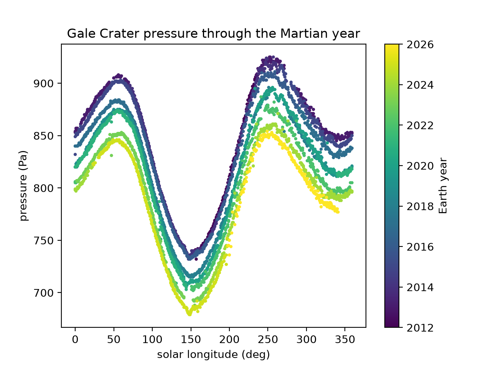

# Mars Weather at Gale Crater

Plots atmospheric pressure measured by NASA's Curiosity rover at Gale Crater across the Martian year, using public NASA weather data.



## What the chart shows
- **x-axis:** solar longitude (Ls), Mars's position in its orbit. 0 to 360 degrees is one Martian year.
- **y-axis:** air pressure in pascals.
- **Colors:** Earth year of each measurement.

## What I found
- Pressure rises and falls every Martian year. Mars's air is mostly CO2, and part of it freezes onto the polar caps in winter and returns to the air in spring.
- Each year's curve sits slightly lower than the one before. One possible explanation is that Curiosity keeps climbing Mount Sharp, where the air is thinner. I haven't tested this yet.

## How it works
- Pulls the data with `requests` and cleans it with `pandas`.
- Flags suspicious temperature readings by comparing each one to its neighbors (rolling median) instead of deleting by eye.
- Plots with `matplotlib`.

## Run it
```
python -m pip install requests pandas matplotlib
python mars_weather.py
```

## Next steps
- Compare pressure against the rover's elevation to test the Mount Sharp idea.
- Plot temperature against solar longitude.
